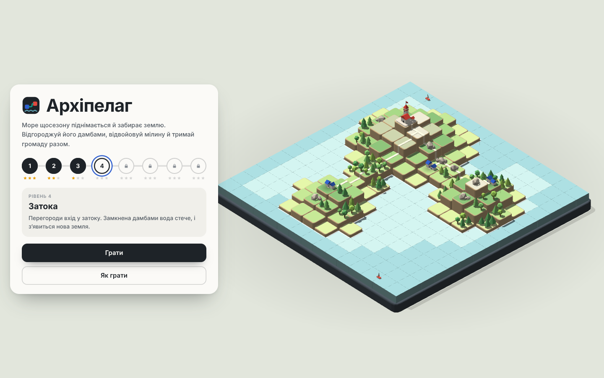
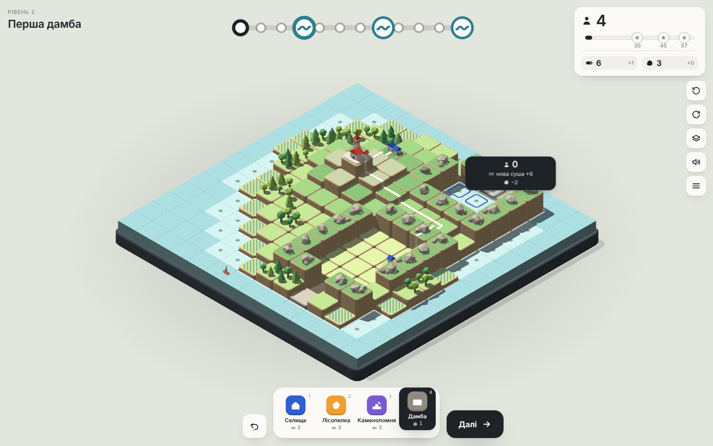
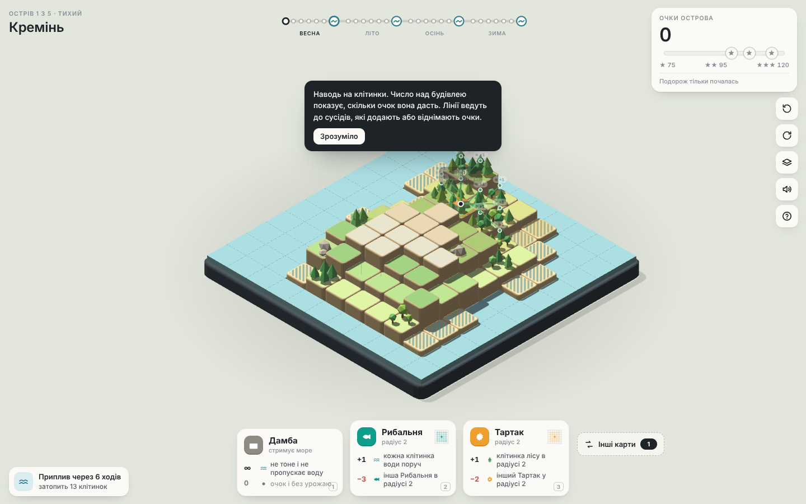
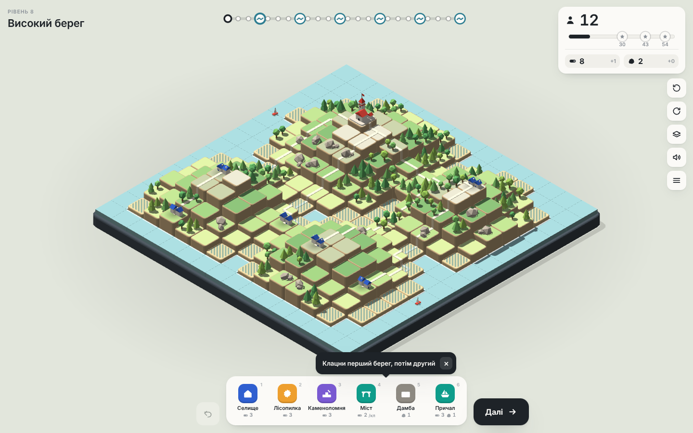

# Архіпелаг

Невелика браузерна гра-головоломка. Море щосезону піднімається й забирає землю, а ти відгороджуєш його дамбами, відвойовуєш мілину й тримаєш острівну громаду разом.

**[Грати в браузері](https://bohdanrybalka.github.io/archipelag-game/)**. Працює на комп'ютері й телефоні, нічого встановлювати не треба.



## Як грати

1. Щодня будуй що хочеш, поки вистачає дерева й каменю. Потім тисни «Далі».
2. Кожні кілька днів приходить приплив: вода піднімається на один уступ і заходить із моря через сторони клітинок. Що опинилось під водою, зникає разом із людьми.
3. Дамба не тоне й не пускає воду. Її можна ставити й на мілину (світла вода). Якщо дамби повністю замкнули ділянку, вода з неї стікає і з'являється нова суша.
4. Селища, до яких веде дорога від міста, після припливу ростуть. Відрізані порожніють. Дамба теж працює як дорога.
5. Наприкінці рахуються всі жителі. Одна зірка відкриває наступний рівень. Рівнів вісім.

| Будівля | Ціна | Що робить |
|---|---|---|
| Селище | 2 дерева | Росте до 4 жителів, поки з'єднане з містом |
| Лісопилка | 3 дерева | Щодня дає дерево за кожен ліс поруч, до 2 |
| Каменоломня | 3 дерева | Щодня дає камінь за кожну скелю поруч, до 2 |
| Дамба | 1 камінь | Тримає воду. Лінію дамб можна протягнути мишею або пальцем |

**Керування:** `1`–`4` обрати будівлю, `Пробіл` наступний день, `Z` скасувати, `Q`/`E` повернути острів, `M` показати, коли заллє кожну клітинку, `Esc` скасувати вибір. Колесо миші або два пальці змінюють масштаб.



## Як це зроблено

Гра почалась як перевірка: чи можна з одного промпту «навайбкодити» цілий застосунок. Код написаний разом із Claude за кілька ітерацій, а кожну наступну версію визначали відгуки після гри.

| Версія | Що було | Пограти |
|---|---|---|
| 1. «Приплив» | Результат першого промпту. Гарна діорама й анімації, але механіка близька до Islanders: карти будівель, очки за сусідство. Дамби майже нічого не рятували. | [archive/pryplyv-v1](https://bohdanrybalka.github.io/archipelag-game/archive/pryplyv-v1/) |
| 2. «Архіпелаг» з мостами | Своя механіка: вода розрізає острів, а селища мають лишатись з'єднаними з містом. Мости, дамби, пороми. Грати стало цікавіше, але більшість будівель давала мало користі. | [archive/archipelag-v2](https://bohdanrybalka.github.io/archipelag-game/archive/archipelag-v2/) |
| 3. «Архіпелаг» з дамбами | Поточна. Мілина, осушення замкнених ділянок, затоплення без евакуації. Мости й пороми прибрані, бо дамба на мілині робить те саме. | [грати](https://bohdanrybalka.github.io/archipelag-game/) |

Головний висновок: перша версія з одного промпту виходить гарною, але порожньою. Цікавою гра стала лише тоді, коли людина пограла й коротко описала, що не так.

Баланс рівнів перевіряв бот (`tools/balance-bot.js`). Він грає кожен рівень у кількох варіантах, а місця для дамб шукає як мінімальний розріз між морем і селищами (max-flow на сітці). Пороги зірок становлять 50%, 75% і 95% від найкращого результату бота.

<p>
  
  
</p>

## Структура

```
index.html            зібрана гра, її віддає GitHub Pages
src/
  logic.js            правила гри без рендеру, працює і в браузері, і в Node
  game.js             рендер на three.js, інтерфейс, анімації, звук
  style.css
  template.html       шаблон сторінки
tools/
  build.js            збирає src/ в index.html
  balance-bot.js      бот для перевірки балансу
  calibrate.js        проганяє бота й записує пороги зірок у src/logic.js
  maps.js             друкує карти рівнів у консоль
  check-map.js        показує, що й коли заллє, з дамбами і без
archive/              попередні версії, в них теж можна пограти
docs/screenshots/
```

## Запуск локально

- Відкрити `index.html` у браузері. Потрібен інтернет, бо three.js і шрифти завантажуються з CDN.
- Після змін у `src/` зібрати сторінку: `node tools/build.js`.
- Перевірити баланс: `node tools/balance-bot.js`. Окремий рівень: `node tools/balance-bot.js 3` (номер з нуля).

Залежностей немає, потрібен лише Node.js 18 або новіший.

## Відомі обмеження

- Дамби зараз сильні: на деяких рівнях можна рано повністю відгородитись, і вода більше не загрожує. Можливі виправлення: дорожчати кожна наступна дамба, шторм розмиває найнижчі дамби, або дамбу треба надбудовувати щоприпливу.
- Гру тестував лише автор, тож складність рівнів 4 і 8 може бути нерівною.
- Прогрес зберігається в `localStorage` браузера.

## English

A small browser puzzle game about a rising sea. Build dikes, reclaim shallow water and keep your island villages connected to the town. Eight levels, plain JavaScript and three.js, no build tools needed. It started as an experiment in building a whole app from a single prompt with Claude; the `archive/` folder keeps the two earlier versions, so you can see how the design changed after each round of playtesting. **[Play it here](https://bohdanrybalka.github.io/archipelag-game/).**

## Ліцензія

[MIT](LICENSE)
